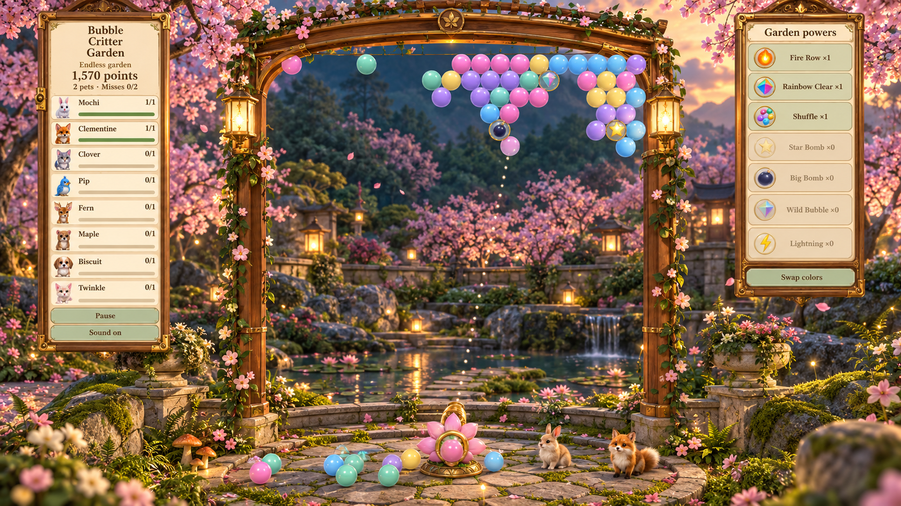
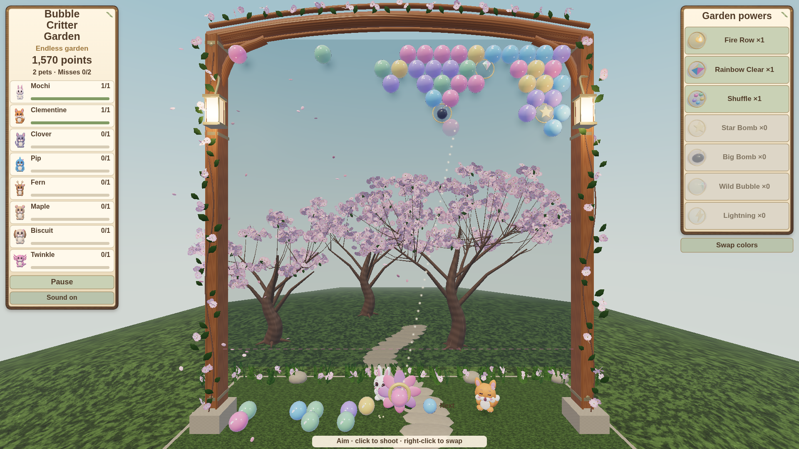
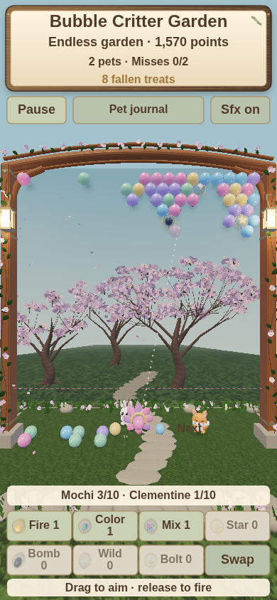

> **Latest local update, 2026-10-21:** All five systems from the new improvement brief are implemented locally: miniature 3D meadow, real forest trees, fieldstone walls, collision-aware pets and score-based aiming assistance. Read [the coordinated update record](docs/garden-environment-update.md) for files, tests, captures and the software-rendering performance limitation. Previous checkpoint notes below are historical.

> **Local update, 2026-10-21:** The user chose warm dusk. A first courtyard environment is implemented locally; see [current progress and Windows setup](docs/local-courtyard-progress.md). Start with `.\scripts\dev-local.cmd` and open `http://127.0.0.1:5173/game.html`. Earlier checkpoint descriptions below are historical.

# Bubble Critter Garden · Project 0 lot 3157

> **Saved for local VS Code continuation — 2026-10-21.** Start with [CONTINUE.md](CONTINUE.md). Stage 1 is live (submission 9001); Stage 2 source and assets are included in this repository and are **not published to Project 0**. The new courtyard/skybox is a proposed design, not implemented scenery. Older notes below describe previous revisions.

**Local development:** clone this repository and open the folder in VS Code. The complete source, models, textures, audio and handoff are included. No separate ZIP download is needed. API keys are excluded.

## The three continuation images

[Open the full preview gallery](docs/preview-gallery.md) · [AI handoff](CONTINUE.md) · [Background design](docs/magical-garden-skybox-design.md)

**Proposed magical garden skybox — concept only**



**Actual Stage 1 desktop game**



**Actual Stage 1 phone game**




A playable pastel 3D bubble shooter inside the existing Garden Pop city display. The supplied [design document](docs/game-design.md) is the product brief; the reference image guides the wooden pavilion, flowers, glossy pastels, and critters. The latest [botanical art direction](docs/game-botanical-art.md), [continuous garden revision](docs/game-continuous-garden.md) and [earlier user changes](docs/game-updates.md) override the original brief. Neither is a replacement for the user's instructions or a flat image pasted into the game.

The city display is a separate miniature attraction: a textured curved wooden pavilion, 25-column pastel bubble board, seven animated rescued critters, decorative animal bubbles, a layered garden island, cherry blossoms, lanterns and a small waterfall. Entering the lot opens the new game with a fixed camera inside the lot, its own opaque setting, and no view of the surrounding city.

## Play

One continuous garden starts with six rows, alternating **20 and 19 touching hexagonal positions**, in five colors. Bubbles are **25% larger** than the earlier game. **Three skill bubbles** are visible from the start and replenished as they are collected. There are no initial trapped pets. Aim with the mouse and click, or drag on a touch screen and release. Match three or more; unsupported, unpopped bubbles fall and remain on the ground until a rescued pet eats them. **Every two unsuccessful regular shots add one top row.** Matches and skills preserve the saved first miss.

Actual clears earn **one trapped baby at a time**. Free its supports to rescue it: play continues, and the pet stays in this garden. Eight different textured 3D species can join: bunny, fox, kitten, bird, deer, bear, puppy, and dreamling. Each pet wanders, blinks, reacts to misses, eats fallen bubbles individually, and produces a usable Big Bomb after every ten actual meals. Popped bubbles never count as food.

The board replenishes empty ceiling cells as it clears, preserving pets, ground food, inventory and score without shifting existing bubbles. Only ceiling-connected bubbles reaching the danger line end the run. The interface has no level selection, Next Level or rescue victory modal. Restart explicitly resets the garden. Running and final scores use Project 0's weekly leaderboard.

Collect Fire Row, Rainbow Clear, Shuffle, Star Bomb, Big Bomb, Wild Bubble and Lightning by dropping their skill bubbles. Select a collected skill and its target to use it; powers do not incur the missed-shot penalty. Right-click, tap Swap or press X to exchange current and next colors. R restarts, P pauses, arrow keys and Space also aim/fire; Esc leaves. Music and SFX have separate settings.

The game now uses a natural timber-and-brass frame, three textured cherry trees with curved petal geometry, smaller botanical flowers and veined foliage. Seven illustrated skill emblems follow the bubbles’ curved surfaces and appear in the inventory. Original PBR maps, pearl-film bubbles, captured reflections, HDR highlights, lanterns and contact shadows supply depth. The interior remains enclosed and separate from the street model.

**This version uses single-player sessions (`maxPlayers: 1`). Cooperative synchronization is not implemented.** Continue retains the current game during the visit; progress is not stored between visits. Project 0 retains supported weekly scores for signed-in players.

## Develop and verify

Use the existing checkout at `/workspace/Garden-Pop`. Requires Node 24, npm, Blender 4.3 for street models, Chromium for browser tests, and Python with Pillow plus FFmpeg for regenerating original textures/audio.

```sh
npm ci --cache /workspace/.cache/npm --no-audit --no-fund
npm run dev
npm run build
```

The root page reviews the city display. `game.html` is the local playable review page; both pages build into `dist/`. The city receives readable ES modules from `public/experience/`, rather than the minified website build.

```sh
npm run check:art           # eight UV-mapped animal species, visible cached clones and bubble bounds
npm run check:game          # rules + continuous real-shot play through rescues/refills
npm run check:game:browser  # own Vite server, real continuing rescues/loss, skills, touch and menus
npm run check:game:botanical # current botanical scene, skill emblems, real rescue, desktop/phone
npm run check:devkit        # official Project 0 sandbox: desktop/phone, shots, pause, reconnect
npm run check:models        # all three exterior LOD geometry/PBR/texture/file budgets and bounds
npm run check:browser       # exterior rendering, street captures, critter picking and phone layout
npm run models              # rebuild ONLY exterior assets with Blender; preserves the game
npm run check:browser       # existing city/gallery viewer, controls and phone layout
```

Browser tests use system Chromium and software WebGL; screenshots go to `docs/previews/`. The game scales 3D rendering down when actual frames are slow, while rendering text and touch targets at native resolution. HUD text uses larger type (at least 16 CSS pixels) and a canvas matched to the screen pixel density up to 2×, without the old 1280-pixel cap on interface rendering. Starting grids, rescue formations and new rows use seeded mixed colors with small connected patches, rather than color bands. The basket/flower launcher is removed so the shooting ball is visible by itself.

Geometry/materials are shared and static geometry is merged while preserving indices; bubbles, glints, particles, petals and water drops use instancing. Particle counts are bounded. Retry reuses cached animal and special-bubble geometry.

Official sandbox tests need the existing HTTPS proxy and its installed CA trusted in Chromium's NSS database. The user explicitly approved that certificate trust change. Retain TLS verification. Test scripts keep proxy credentials out of output.

## Source and original assets

- `src/experience/main.js`: actual entry, input, menus, running/final score reporting, and fixed camera.
- `src/experience/game/rules.js`: renderer-independent hex grid, analytic collisions, matches, row insertion, continuous replenishment, earned pets, food, powers, scoring, and serializable state.
- `src/experience/game/art.js`: UV-mapped PBR pavilion, plants, wood, stone, textured creatures and expressive faces; `view.js` supplies instanced bubbles, 3D power icons, rescue/feeding/collection animation and effects.
- `ui.js`, `audio.js`, `ambience.js`, `render.js`: responsive interface, original audio, animated petals/water, and separate rendering resolutions for scenery and readable UI.
- `scripts/sync-experience.mjs`: copies canonical experience source into the readable publication package. Run by `npm run build`.
- `src/experience/game/botanical.js`: current modelled cherry grove, tapered trunks, blossom/leaf instances, timber frame, stone paths and lamps.
- `scripts/create-botanical-assets.py`: original cherry bark/petal/leaf PBR maps and seven-symbol transparent skill atlas. Included in `game:assets`.
- `scripts/create-garden-surfaces.py`: current original 512px color/normal/roughness maps, pearl-film and contact textures. Included in `game:assets`; `game:surfaces` regenerates these maps alone.
- `scripts/create-game-assets.py`: seeded original texture/roughness maps and synthesized effects/music. `npm run game:assets` regenerates them without paid services. No reference-image pixels or third-party characters are used.
- `public/lot/`, `scripts/build_exterior.py`, `scripts/create-exterior-textures.py`, `src/main.js`: separate street display, original procedural Blender geometry/PBR atlas generator, and local gallery. `npm run models` writes only street assets, never the playable package. The older `build_garden.py`, packing and flow files are retained historical sources and are not the current exterior builder.
- `docs/project0-*.md`, `docs/lot3157.json`: cached technical references and verified 12 × 12 × 19 m lot metadata. `docs/publication.json` records confirmed live versions and previous deployments.

Textures, synthesized sound, music, models and game code are original Garden Pop work. Gallery fonts retain their bundled OFL licenses. The game uses no network requests outside its own package and the platform's supported APIs.

## Publish

`scripts/project0.py` reads the existing securely injected `P0_KEY`, sends it only to `https://project0.city`, and never saves it to disk or browser code. Reuse that binding; do not put credentials in this repository or logs.

```sh
python3 scripts/project0.py building
python3 scripts/project0.py validate-experience
python3 scripts/project0.py publish-experience
python3 scripts/project0.py done
```

Validate changes before publishing; a 202 means review is pending, so poll its returned check address rather than publishing twice. For changed street models, use `validate-lot` and `publish-lot` separately. Successful local tests or validation alone do not establish a live publication.

Existing visitors must press Esc and enter the lot again to load a newly published version. Refresh the city for street changes. Publishing the cloud environment snapshot through environment settings is a separate action from publishing the game to Project 0.

## Current exterior publication

The miniature pavilion exterior is confirmed live as street submission 8719, version `0f2d008c227885da-4dec2914a81eaf1e`. The animated-animal game revision is confirmed live as experience submission 8722, version `8fd3edf4fe385243`; the gameplay rules are unchanged. See [street render](docs/previews/exterior-street-front.png), [reference comparison](docs/exterior-comparison.md), [LOD stats](docs/exterior-model-stats.json) and [verification](docs/exterior-verification.json). Project 0 validated and reviewed all LODs with no warnings. The required city box is subtle with a pastel outline. The street renders use the exact uploaded GLB; the environment proxy blocks direct CDN downloads of the optimized live asset. The updated cloud setup draft includes the CDN domain for future review/publication; draft saving does not apply its network setting to this task.

## Animated animal revision

The latest animal reference is implemented as original textured mesh characters with facial morphs, not as sprites. The street family contains seven species, including deer, bear and a pink axolotl; the playable game preserves its existing progression identities and rules. See [implementation](docs/animated-animal-art.md), [actual mesh render](docs/previews/mesh-animals-smile.png), and [sad pose](docs/previews/mesh-animals-sad.png). `animal-art.html` is a local interactive mesh review page. `npm run animal:assets` regenerates the playable GLB; `npm run models` regenerates all street LODs. The Blender UV handle is reacquired after allocating vertex colors; preserve the UV/color-corruption regression. Live versions are always recorded in docs/publication.json.

The current continuous-garden experience is independently verified live: submission 8959, version `23769b71cc914f68`. See [current gameplay revision](docs/game-continuous-garden.md) and [preview](docs/previews/continuous-garden-rescued-pets.png). Older publication notes above describe prior revisions.
